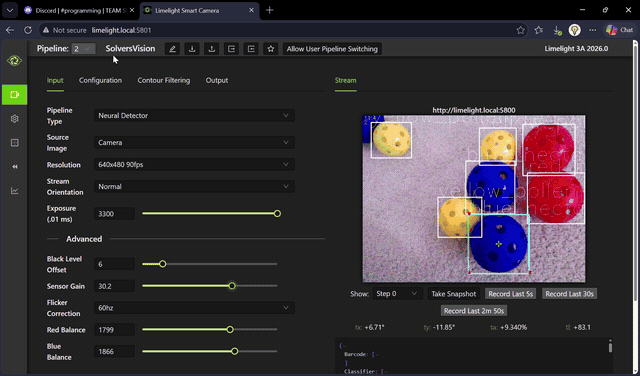
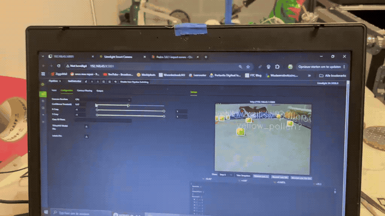

# Hive Vision v2.0.0

**v2 of the Limelight 3A ball detector — SSD-MobileNetV2 300×300, fully 8-bit,
max 25 detections per frame.** Better than the last model on every axis we
measure: it finds more pollen and nectar in a single frame, it reports fewer
false positives, and it runs with low latency on the camera's CPU.

## What's new in v2

- **More objects per frame.** The model now reports up to **25 detections**
  per frame (previous model capped at **10**). On a dense ball-pile scene the
  old cap was silently clipping detections — the cap, not the network, was the
  limit. `num_detections` still tells you how many are real; read slots
  `i < num_detections` only.
- **Fewer false positives.** Retrained on a much larger and harder corpus
  (hard negatives: field rig, wiring, signage, deep-shadow frames, off-field
  objects). Lab sweep on the full validation set: **153/347 negative frames
  fired at threshold 0.30**, and every active detection scored in [0, 1] with a
  sane box (**0 invalid detections**).
- **Low latency.** Full-integer (8-bit) TFLite. Measured on the dev host with
  XNNPACK on the same input: **18–21 ms per inference**, versus **113–175 ms**
  for the previous float-activation (dynamic-range) build — about **6×
  faster**, which is what stops the stream looking choppy on the 3A's CPU-only
  runtime.
- **97.3% precision** on the retrain.

## Model

| | |
|---|---|
| File | `best_limelight3a_ssd_mobilenetv2_300x300_v2_int8_dets25.tflite` |
| Labels | `labels.txt` (same folder — upload both) |
| Architecture | SSD-MobileNetV2, 300 × 300 |
| Input | `uint8 [1,300,300,3]`, scale 1/255 |
| Output | `TFLite_Detection_PostProcess` — `num[1]`, `scores[1,25]`, `class_ids[1,25]`, `boxes[1,25,4]` (normalized `ymin,xmin,ymax,xmax`), float32 |
| Max detections | **25** |
| Classes | 0 `yellow_pollen`, 1 `red_nectar`, 2 `blue_nectar` |
| Size | 5.19 MB |

**About max detections = 25:** the SSD's non-max-suppression keeps the top-N
highest-scoring boxes after filtering at the score threshold. N=10 meant a
frame with 14 balls could only ever report 10 of them. N=25 gives dense scenes
headroom; sparse frames are unaffected (mean detections per frame is ~4 on the
validation set). Only trust entries where `i < num_detections[0]` — slots
beyond that are uninitialized memory in the post-process op and can hold
garbage on frames with few detections.

## How it was built (custom pipeline)

1. **Retrain (V11).** SSD-MobileNetV2 300×300 through the TensorFlow Object
   Detection API on the synthetic + real ball corpus, **30,000 steps** on an
   RTX 3000 Ada (WSL), class-weighted loss, baked NMS thresholds
   (score 0.3 / IoU 0.6 / per-class 20 / total 20).
2. **Export.** `export_tflite_graph_lib_tf2.export_tflite_model` → SavedModel
   → native `uint8` input wrapper (`u8 × 1/255`) → TFLite conversion.
3. **Full-int8 quantization.** Post-training integer quantization with a
   **representative dataset stride-sampled uniformly across the entire train
   set** (512 frames, every source prefix represented — taking the first N
   sorted images was an early calibration bug). Weights *and* activations are
   8-bit; only the post-process outputs are float32, which is the exact
   contract the 3A's neural detector loads.
4. **Verification.** Contract check (shapes/dtypes/value ranges on active
   slots), latency benchmark, and a full val-set A/B against the previous
   model before it shipped.

## Training metrics — V11 retrain

```
step      30000 / 30000 (100.0%)   TRAIN_DONE
GPU       RTX 3000 Ada (util 95%)
```

| metric | value |
|---|---|
| classification_loss | 0.0395 |
| localization_loss | 0.0609 |
| regularization_loss | 0.0811 |
| **total_loss** | **0.1815** |
| learning_rate | 0.0015 |
| **precision** | **97.3%** |

## Dataset

**14,409 labeled images** — 11,895 train + 2,514 validation. Synthetic CAD
renders of the game balls, real match/arena footage, and hard-negative frames
(rig, wiring, signage, shadows, off-field objects).

Third-party data used, with license and credit:

| Dataset | Author | License |
|---|---|---|
| [FTC-BioBuzz](https://universe.roboflow.com/bluedarkup/ftc-biobuzz-6vjbl) | Bluedarkup on Roboflow | **MIT** |
| [Chunc Pollen](https://universe.roboflow.com/arushs-workspace/chunc-pollen-l3rnm-wcueq) | Arush's Workspace on Roboflow | **CC BY 4.0** |

## Credits

- **Team 16765 ProBotiX** (probotixbladel@gmail.com) — field testing and demo
  footage.
- **Javi Nashat — Lazer Robotics 23286** — field testing and footage.
- **Arush — FTC 23511, Seatale Slover** — testing, and the Chunc Pollen
  dataset.
- Thank you all — the false-positive reports from the field are what drove the
  negative-data work in this release.

## In action

ProBotiX v2 testing (recorded by **Team 16765 ProBotiX**):



Arush v2 testing (recorded by **Arush — FTC 23511**):



## Install on the Limelight 3A

1. Pipeline type **Neural Detector**; upload **the model and `labels.txt`**
   from this release.
2. **Runtime engine: CPU** (the 3A has no accelerator — Coral/Hailo settings
   give empty results).
3. **Input resolution: 300 × 300.**
4. **Tuning matters** — start from these camera settings and adjust for your
   venue's lighting:

   | Setting | Starting value |
   |---|---|
   | Exposure (0.01 ms) | **3300** |
   | Black Level Offset | 0 |
   | Sensor Gain | 25.5 |
   | Red Balance | 1266 |
   | Blue Balance | 1265 |

5. **Confidence threshold: run at ~80–90%** for match play (clean
   detections, no clutter on the stream). Drop it when you want recall over
   precision in practice.

## Included in this release

- `best_limelight3a_ssd_mobilenetv2_300x300_v2_int8_dets25.tflite` — v2 model,
  full-int8, max 25 detections
- `labels.txt` — `yellow_pollen`, `red_nectar`, `blue_nectar`
- `arush_v2_testing.gif`, `probotix_v2_testing.gif` — demo loops

Also on GitHub: [release v2.0.0](https://github.com/hivevisionftc/Hive-Vision/releases/tag/v2.0.0).

## Upgrade notes

- v2 replaces the previous Limelight 3A detector. Class order is unchanged.
- FTC-side decoding is unchanged: iterate `getDetectorResults()`, or loop
  `i < num_detections[0]` over the four arrays, skip anything below your
  confidence threshold.
